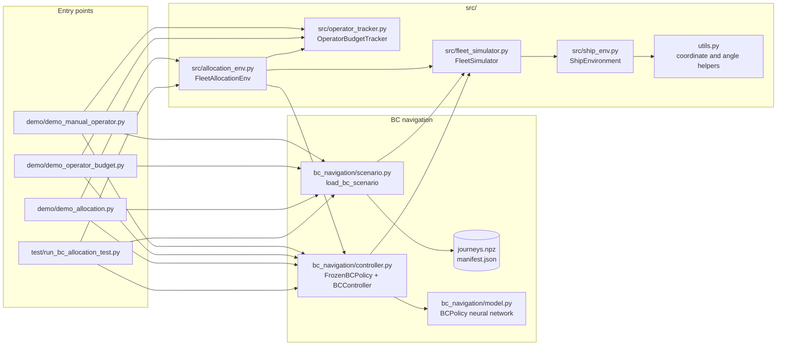
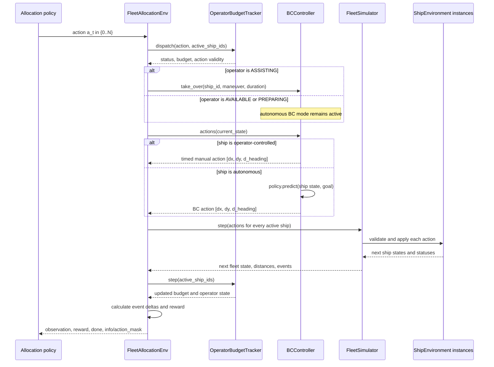

# Ship Operator Low-Level Code Flow

This document describes the runtime path after the project restructuring. The
two demos are user-facing entry points; the reusable simulator and operator
allocation code lives under `src/`.

## Component flow



The grey reference line in the demos is drawn from the prepared trajectories
returned by `load_bc_scenario`. It is visualization-only. `BCController`
chooses actions from the live ship state and goal; it does not consume the
reference waypoints.

## One proactive allocation step



## Responsibilities and boundaries

| Component | Responsibility | Does not do |
|---|---|---|
| `load_bc_scenario` | Select valid, synchronized BC journeys and build simulator inputs | Choose navigation actions during the episode |
| `FrozenBCPolicy` | Load the frozen checkpoint and produce turn/speed predictions | Manage ships, budgets, or interventions |
| `BCController` | Convert BC predictions or operator takeover commands into simulator actions | Decide which ship should receive assistance |
| `FleetAllocationEnv` | Expose fixed-shape observations, discrete allocation actions, event rewards, and masks | Train an RL algorithm itself |
| `OperatorBudgetTracker` | Enforce one-operator availability, delay, duration, budget, and intervention metrics | Move ships or calculate navigation commands |
| `FleetSimulator` | Maintain one shared clock, validate actions, update all ships, and measure fleet events | Decide allocation actions |
| `ShipEnvironment` | Store per-ship state, goals, bounds, observations, and retirement status | Coordinate the operator budget |

## State, action, and reward path

`FleetAllocationEnv` produces three observation groups:

- `ships`: one fixed-size row per vessel containing normalized position,
  speed, heading sine/cosine, timestamp, active flag, and assignment flag.
- `nearest_distance`: normalized nearest-neighbour distance for each vessel.
- `operator`: normalized budget, operator status, preparation/assistance
  timers, elapsed assistance, and simulation time.

The allocation action is discrete: `0` means idle and `1..N` selects a vessel.
The controller action sent to `FleetSimulator` is continuous:
`[dx, dy, d_heading]` for each active vessel.

The reward is calculated from events that begin during the current step:

```text
reward = wg * newly_completed_journeys
       - wc * newly_started_collisions
       - wm * newly_started_near_misses
       - wh * accepted_interventions
```

This separation lets the allocation policy learn *when and whom to assist*
without coupling it to the BC navigation model or the simulator's per-ship
kinematics.
